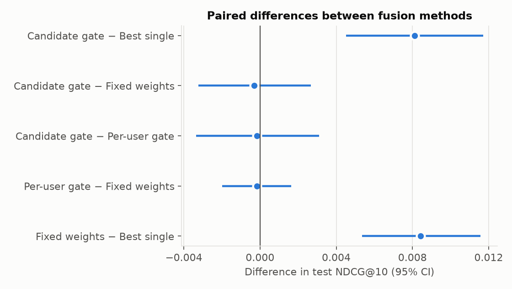
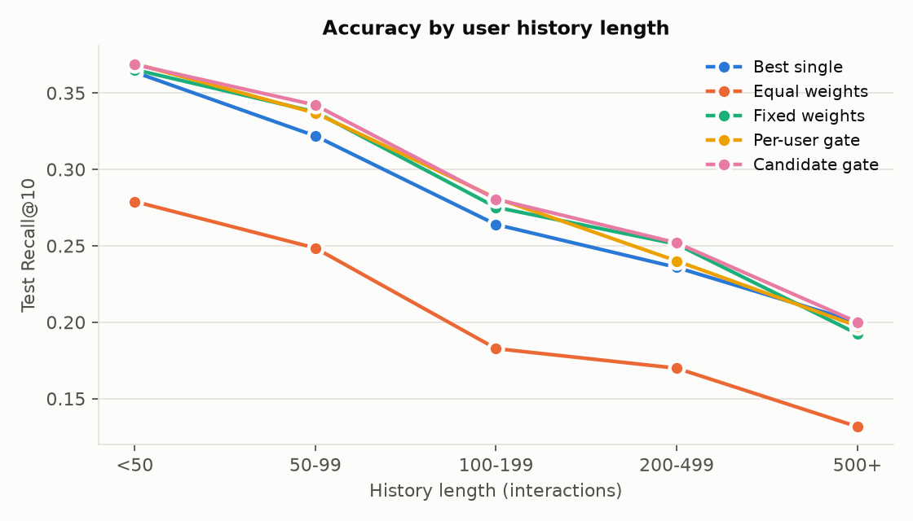
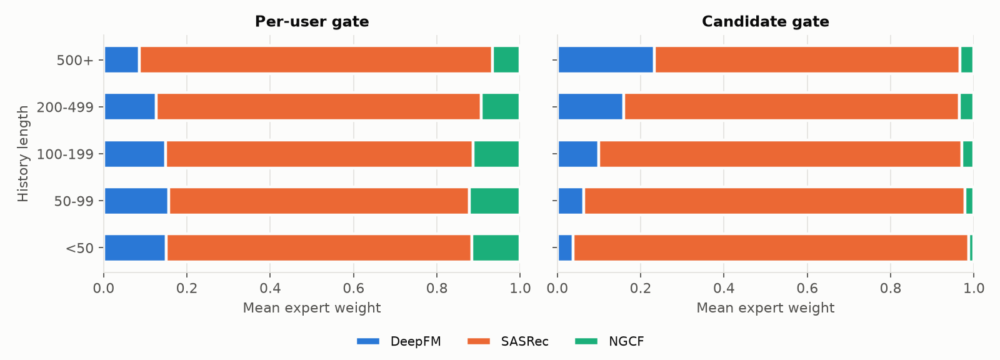
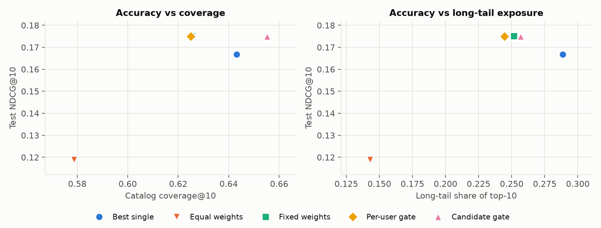
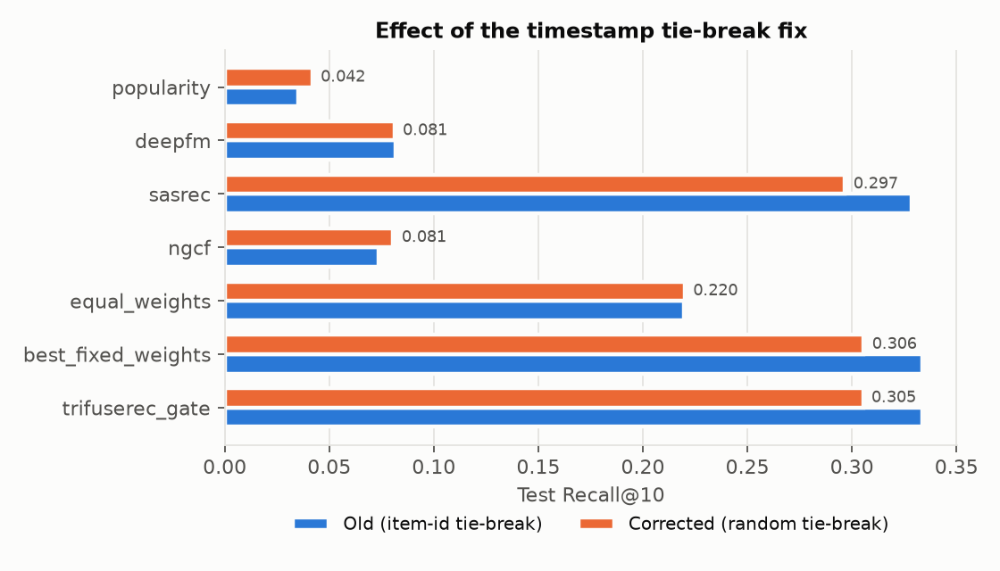

# TriFuseRec results: loo2_seed42_preliminary

Protocol **loo2**, split `fb9ead0d9587`, training seeds [42], normalization `z`, experts ['deepfm', 'sasrec', 'ngcf'].
All methods rank the same candidates (all items minus the user's history) for the same test targets.
**Preliminary:** loo2 arrangement (gates fit on validation targets of 70% of users, selected on the other 30%; base models were early-stopped on validation of all users). The recommended loo3 protocol has not been run yet.
**Single seed:** confidence intervals reflect user sampling only, not training variance.

## RQ1 — Does adaptive fusion beat the strongest single model and fixed fusion?

Best single expert (chosen on the selection set): **sasrec**.

| method | Recall@10 | Recall@20 | NDCG@10 | NDCG@20 | NDCG@10_vs_best_single_% | NDCG@10_vs_fixed_% | Recall@10_vs_best_single_% | Recall@10_vs_fixed_% |
|---|---|---|---|---|---|---|---|---|
| Best single | 0.2967 | 0.4151 | 0.1668 | 0.1967 | 0.0000 | -4.8088 | 0.0000 | -2.9252 |
| Equal weights | 0.2200 | 0.3232 | 0.1189 | 0.1447 | -28.7233 | -32.1508 | -25.8371 | -28.0065 |
| Fixed weights | 0.3056 | 0.4257 | 0.1752 | 0.2056 | 5.0517 | 0.0000 | 3.0134 | 0.0000 |
| Per-user gate | 0.3061 | 0.4230 | 0.1750 | 0.2046 | 4.9543 | -0.0927 | 3.1808 | 0.1625 |
| Candidate gate | 0.3094 | 0.4237 | 0.1749 | 0.2037 | 4.8619 | -0.1806 | 4.2969 | 1.2459 |

Paired bootstrap over users (10,000 resamples, 95% percentile CI):

| comparison | metric | mean_diff | ci_low | ci_high | p_value | verdict |
|---|---|---|---|---|---|---|
| Candidate gate − Best single | NDCG@10 | 0.0081 | 0.0045 | 0.0117 | 0.0000 | positive (CI above 0) |
| Candidate gate − Best single | Recall@10 | 0.0127 | 0.0060 | 0.0195 | 0.0000 | positive (CI above 0) |
| Candidate gate − Best single | NDCG@20 | 0.0070 | 0.0038 | 0.0103 | 0.0000 | positive (CI above 0) |
| Candidate gate − Fixed weights | NDCG@10 | -0.0003 | -0.0032 | 0.0027 | 0.8226 | inconclusive (CI spans 0) |
| Candidate gate − Fixed weights | Recall@10 | 0.0038 | -0.0023 | 0.0096 | 0.2328 | inconclusive (CI spans 0) |
| Candidate gate − Fixed weights | NDCG@20 | -0.0018 | -0.0044 | 0.0008 | 0.1858 | inconclusive (CI spans 0) |
| Candidate gate − Per-user gate | NDCG@10 | -0.0002 | -0.0034 | 0.0031 | 0.9120 | inconclusive (CI spans 0) |
| Candidate gate − Per-user gate | Recall@10 | 0.0033 | -0.0031 | 0.0096 | 0.3136 | inconclusive (CI spans 0) |
| Candidate gate − Per-user gate | NDCG@20 | -0.0009 | -0.0037 | 0.0020 | 0.5278 | inconclusive (CI spans 0) |
| Per-user gate − Fixed weights | NDCG@10 | -0.0002 | -0.0020 | 0.0016 | 0.8796 | inconclusive (CI spans 0) |
| Per-user gate − Fixed weights | Recall@10 | 0.0005 | -0.0033 | 0.0043 | 0.8272 | inconclusive (CI spans 0) |
| Per-user gate − Fixed weights | NDCG@20 | -0.0009 | -0.0026 | 0.0008 | 0.2908 | inconclusive (CI spans 0) |
| Fixed weights − Best single | NDCG@10 | 0.0084 | 0.0054 | 0.0116 | 0.0000 | positive (CI above 0) |
| Fixed weights − Best single | Recall@10 | 0.0089 | 0.0030 | 0.0149 | 0.0032 | positive (CI above 0) |
| Fixed weights − Best single | NDCG@20 | 0.0088 | 0.0060 | 0.0117 | 0.0000 | positive (CI above 0) |

## RQ2 — Which users benefit?

History length (= user degree in the interaction graph, incl. held-out history), test Recall@10:

| history_len | users | Best single | Equal weights | Fixed weights | Per-user gate | Candidate gate |
|---|---|---|---|---|---|---|
| <50 | 1796 | 0.3636 | 0.2790 | 0.3653 | 0.3692 | 0.3686 |
| 50-99 | 1336 | 0.3219 | 0.2485 | 0.3376 | 0.3368 | 0.3421 |
| 100-199 | 1330 | 0.2639 | 0.1827 | 0.2752 | 0.2812 | 0.2805 |
| 200-499 | 1183 | 0.2358 | 0.1699 | 0.2511 | 0.2401 | 0.2519 |
| 500+ | 395 | 0.2000 | 0.1316 | 0.1924 | 0.1975 | 0.2000 |

Activity rate (interactions per active day) quartiles, test Recall@10:

| activity | users | Best single | Equal weights | Fixed weights | Per-user gate | Candidate gate |
|---|---|---|---|---|---|---|
| Q1 least | 1510 | 0.1854 | 0.1623 | 0.1974 | 0.2013 | 0.2046 |
| Q2 | 1510 | 0.3556 | 0.2576 | 0.3570 | 0.3530 | 0.3596 |
| Q3 | 1510 | 0.3344 | 0.2583 | 0.3397 | 0.3450 | 0.3477 |
| Q4 most | 1510 | 0.3113 | 0.2020 | 0.3285 | 0.3252 | 0.3258 |

Target item popularity (head = top 20% by train count); the tail row is **Tail Recall@10**:

| target_item | users | Best single | Equal weights | Fixed weights | Per-user gate | Candidate gate |
|---|---|---|---|---|---|---|
| head | 3502 | 0.3681 | 0.3050 | 0.3878 | 0.3895 | 0.3872 |
| tail | 2538 | 0.1982 | 0.1028 | 0.1923 | 0.1911 | 0.2021 |

Users missed by the strongest single expert (gains here are what fusion can add; losses on hit users are its cost):

| method | users | Recall@10 on users the best single model misses | Recall@10 on users it hits |
|---|---|---|---|
| Best single | 4248 | 0.0000 | 1.0000 |
| Equal weights | 4248 | 0.0869 | 0.5357 |
| Fixed weights | 4248 | 0.0473 | 0.9180 |
| Per-user gate | 4248 | 0.0579 | 0.8945 |
| Candidate gate | 4248 | 0.0610 | 0.8984 |

## RQ3 — Does candidate-aware gating use complementary experts better than per-user gating?

Gate-weight distributions on test (weights on each user's top-10 recommendations, averaged over seeds):

| gate | mean w_deepfm | mean w_sasrec | mean w_ngcf | p10-p90 w_deepfm | p10-p90 w_sasrec | p10-p90 w_ngcf | within-user std across top-10 items |
|---|---|---|---|---|---|---|---|
| Per-user gate | 0.1424 | 0.7481 | 0.1094 | 0.09-0.18 | 0.68-0.84 | 0.06-0.15 | 0.0000 |
| Candidate gate | 0.0936 | 0.8824 | 0.0240 | 0.02-0.22 | 0.72-0.97 | 0.01-0.05 | 0.0339 |

Per-user gate — mean weights by history length:

| history_len | deepfm | sasrec | ngcf |
|---|---|---|---|
| <50 | 0.1501 | 0.7330 | 0.1169 |
| 50-99 | 0.1562 | 0.7223 | 0.1215 |
| 100-199 | 0.1489 | 0.7372 | 0.1138 |
| 200-499 | 0.1268 | 0.7796 | 0.0937 |
| 500+ | 0.0859 | 0.8469 | 0.0672 |

Candidate gate — mean weights by history length:

| history_len | deepfm | sasrec | ngcf |
|---|---|---|---|
| <50 | 0.0375 | 0.9494 | 0.0131 |
| 50-99 | 0.0639 | 0.9149 | 0.0212 |
| 100-199 | 0.0991 | 0.8724 | 0.0285 |
| 200-499 | 0.1596 | 0.8052 | 0.0353 |
| 500+ | 0.2336 | 0.7322 | 0.0342 |

Candidate-gate weights on the held-out target item (diagnostic only; targets are never gate inputs):

| users | w_deepfm on target item | w_sasrec on target item | w_ngcf on target item |
|---|---|---|---|
| best single misses | 0.1469 | 0.8012 | 0.0519 |
| best single hits | 0.0835 | 0.8919 | 0.0246 |

## RQ4 — Effect on diversity and popularity bias

| method | NDCG@10 | coverage@10 | long_tail_share@10 | tail_Recall@10 |
|---|---|---|---|---|
| Best single | 0.1668 | 0.6431 | 0.2886 | 0.1982 |
| Equal weights | 0.1189 | 0.5787 | 0.1429 | 0.1028 |
| Fixed weights | 0.1752 | 0.6253 | 0.2515 | 0.1923 |
| Per-user gate | 0.1750 | 0.6250 | 0.2444 | 0.1911 |
| Candidate gate | 0.1749 | 0.6552 | 0.2568 | 0.2021 |

_Points that nearly coincide in the figure (e.g. fixed weights and the per-user gate) are separated in the table above._

## Timestamp tie-break fix (seed 42, loo2, not paired)

| method | Recall@10_old | Recall@10_new | Recall@10_rel% | NDCG@10_old | NDCG@10_new | NDCG@10_rel% |
|---|---|---|---|---|---|---|
| popularity | 0.0353 | 0.0419 | 18.7793 | 0.0173 | 0.0207 | 19.4017 |
| deepfm | 0.0818 | 0.0811 | -0.8097 | 0.0389 | 0.0386 | -0.9302 |
| sasrec | 0.3286 | 0.2967 | -9.7229 | 0.1950 | 0.1668 | -14.4595 |
| ngcf | 0.0737 | 0.0806 | 9.4382 | 0.0368 | 0.0406 | 10.2671 |
| equal_weights | 0.2197 | 0.2200 | 0.1507 | 0.1246 | 0.1189 | -4.6078 |
| best_fixed_weights | 0.3338 | 0.3056 | -8.4325 | 0.1998 | 0.1752 | -12.3132 |
| trifuserec_gate | 0.3336 | 0.3053 | -8.4864 | 0.2000 | 0.1761 | -11.9382 |

## Ablations

Not run yet. See `configs/ablations.json` and the commands in README.
